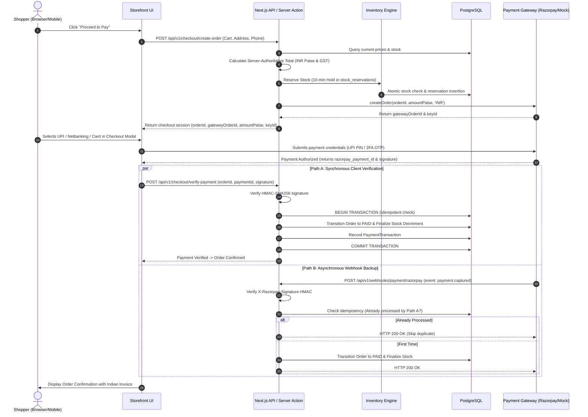
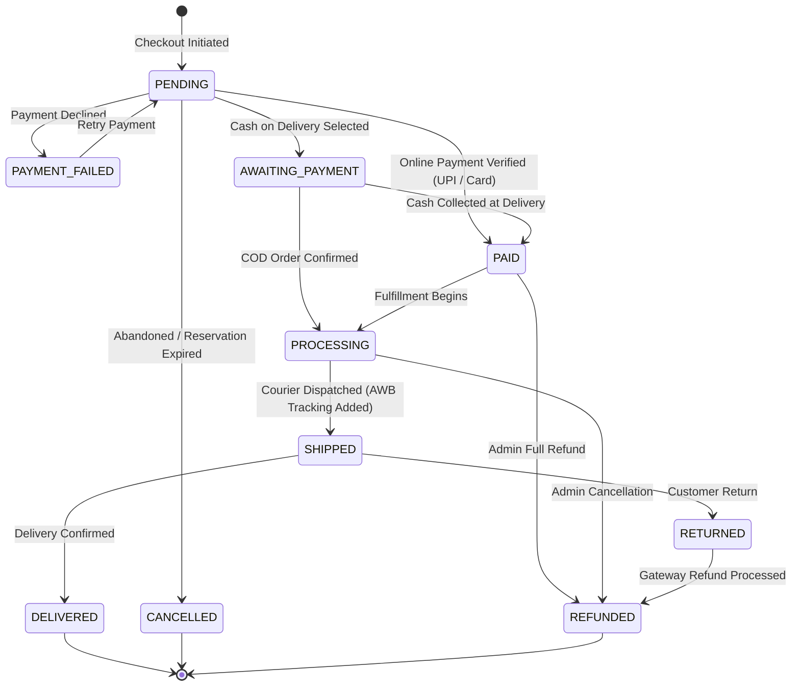

# System Architecture Document

**Project:** Modern Enterprise E-Commerce Platform (India-Focused)  
**Document Version:** 1.1.0  
**Architectural Pattern:** Modular Monolith (Domain-Driven Design)  

---

## 1. Architectural Principles & Strategy

### 1.1 Modular Monolith Rationale
For a production-grade e-commerce application, a **Modular Monolith** provides:
- Single deployment unit with strict internal domain boundaries (`src/modules/*`).
- In-memory function invocations across domains rather than distributed HTTP/gRPC overhead.
- Atomic ACID transactions for checkout and inventory operations within PostgreSQL.
- Flexible payment gateway abstraction allowing zero-dependency local development (via Mock Gateway) while natively integrating India-focused payment providers (Razorpay, COD).

---

## 2. High-Level System Architecture

### 2.1 Topology & Infrastructure Diagram

```mermaid
flowchart TD
    Client["Clients (Browser / Mobile Web)"]
    CDN["Edge Network / CDN (Cloudflare / Vercel Edge)"]
    AppServer["Next.js Application Server (Node.js LTS)"]
    
    subgraph CoreDomains ["Modular Monolith Domain Core"]
        AuthMod["Auth & RBAC Module"]
        CatalogMod["Catalog & Search Module"]
        CartMod["Cart & Pricing Module"]
        CheckoutMod["Checkout & Order Module"]
        InvMod["Inventory Engine"]
        PayMod["Payment Gateway Abstraction (IPaymentGateway)"]
    end

    subgraph PaymentAdapters ["Payment Gateway Providers"]
        MockGW["MockPaymentGateway (Local / Dev)"]
        RazorpayGW["RazorpayGateway (UPI / Cards / Netbanking)"]
        CODGW["CashOnDeliveryGateway (Offline Settlement)"]
    end

    subgraph DataStorage ["Data & Cache Tier"]
        PG[("PostgreSQL 16 Primary DB")]
        RedisStore[("Redis Cache & Distributed Locks")]
    end

    subgraph ExternalServices ["External Services"]
        RazorpayAPI["Razorpay API & Webhooks"]
        EmailService["Transactional Email (Resend / SES)"]
        S3Storage["Object Storage (S3 / Cloudflare R2)"]
    end

    Client -->|HTTPS / TLS 1.3| CDN
    CDN -->|Reverse Proxy / SSR| AppServer
    AppServer --> CoreDomains
    
    CatalogMod -->|Read Cache| RedisStore
    CatalogMod -->|Read / Write| PG
    CartMod -->|Session Sync| RedisStore
    CheckoutMod -->|ACID Transactions| PG
    InvMod -->|Atomic Decrements / Hold| PG
    InvMod -->|Distributed Locks (Optional)| RedisStore

    PayMod --> MockGW
    PayMod --> RazorpayGW
    PayMod --> CODGW

    RazorpayGW -->|Orders API / Verification| RazorpayAPI
    RazorpayAPI -->|Signed Webhooks| PayMod
    CheckoutMod -->|Enqueue Email| EmailService
    CatalogMod -->|Serve Image Assets| S3Storage
```

---

## 3. Component & Module Breakdown

All business logic is isolated within domain modules under `src/modules/`:

| Module | Responsibilities | Key Dependencies |
| :--- | :--- | :--- |
| **`auth`** | User authentication, registration, session validation, password hashing, RBAC guards. | NextAuth / Jose, Prisma DB |
| **`catalog`** | Product catalog querying, category trees, SKU variant management, full-text search. | Prisma DB, Redis (cache) |
| **`cart`** | Cart persistence (cookie/Redis for guests, DB for users), item addition, quantity updates, coupon calculations. | Redis, Prisma DB |
| **`checkout`** | Checkout session orchestrator, GST calculation (CGST/SGST/IGST), order creation, order state transitions. | `cart`, `inventory`, `payment` |
| **`inventory`** | Stock reservation, concurrency control, atomic quantity decrements, release of expired holds. | Prisma DB, `stock_reservations` table |
| **`payment`** | Gateway interface (`IPaymentGateway`), Razorpay client, Mock Gateway, webhook signature verification, idempotency records. | Razorpay SDK / Node Crypto, Prisma DB |
| **`notification`** | Transactional email generation, order confirmation templates, background queue workers. | Resend / Nodemailer |

---

## 4. Payment Gateway Abstraction (`IPaymentGateway`)

To ensure that lack of third-party credentials never blocks development, testing, or CI, payment operations are mediated by an interface:

```typescript
export interface CreatePaymentOrderInput {
  orderId: string;
  orderNumber: string;
  amountPaise: number; // e.g. 49900 for ₹499.00
  currency: 'INR';
  customer: {
    name: string;
    email: string;
    phone: string;
  };
}

export interface PaymentOrderResult {
  gatewayOrderId: string;
  amountPaise: number;
  currency: 'INR';
  provider: 'MOCK' | 'RAZORPAY' | 'COD';
  keyId?: string; // Client publishable key
}

export interface VerifyPaymentInput {
  gatewayOrderId: string;
  gatewayPaymentId: string;
  signature: string;
}

export interface IPaymentGateway {
  createOrder(input: CreatePaymentOrderInput): Promise<PaymentOrderResult>;
  verifyPayment(input: VerifyPaymentInput): Promise<boolean>;
  processRefund(paymentTransactionId: string, amountPaise: number): Promise<boolean>;
}
```

- When `PAYMENT_PROVIDER=MOCK` (default): `MockPaymentGateway` instantly generates mock gateway orders and signs mock payloads.
- When `PAYMENT_PROVIDER=RAZORPAY`: `RazorpayGateway` invokes Razorpay's API and validates signatures using `crypto.createHmac('sha256', secret)`.
- When payment method is `COD`: `CashOnDeliveryGateway` creates an offline order record in status `AWAITING_PAYMENT`.

---

## 5. End-to-End Indian Checkout & Payment Sequence



---

## 6. Order State Machine



---

## 7. Concurrency & Inventory Protection Strategy

### 7.1 Prevention of Overselling
1. **Database Constraint:** Check constraint: `CONSTRAINT stock_non_negative CHECK (stock_quantity >= 0)`.
2. **Conditional Atomic Decrement:**
   ```sql
   UPDATE "ProductVariant"
   SET "stock_quantity" = "stock_quantity" - :requested_qty,
       "updated_at" = NOW()
   WHERE "id" = :variant_id
     AND "stock_quantity" >= :requested_qty;
   ```
3. **Dedicated `StockReservation` Entity:** Holds a 10-minute hold (`expires_at = NOW() + INTERVAL '10 minutes'`). If payment fails or expires, a scheduled cleanup releases reserved stock.

---

## 8. Order Address Snapshot Isolation

To protect legal, tax, and courier delivery integrity:
- An `Order` stores a **frozen JSONB snapshot** (or dedicated table columns) of the recipient name, phone number, address lines, city, state, and 6-digit PIN code.
- If a customer later edits or removes an address from their profile address book, **past order records remain strictly immutable**.
