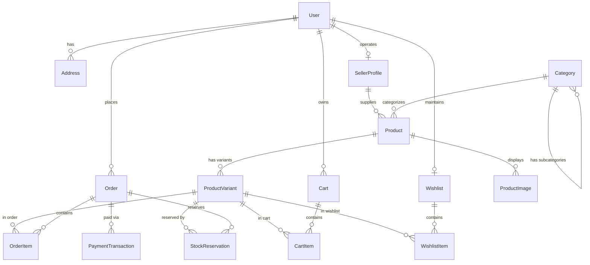

# Database Schema Specification

**Project:** Modern Enterprise E-Commerce Platform (India-Focused)  
**Database Engine:** PostgreSQL 16+  
**ORM:** Prisma ORM  
**Document Version:** 1.1.0  
**Currency Standard:** Indian Rupee (INR - ₹)  

---

## 1. Schema Design Principles

1. **Relational Integrity & Immutability:** Foreign key constraints with explicit `ON DELETE` rules. Orders, Order Items, and Payment Transactions are strictly immutable once finalized.
2. **Order Address Snapshotting:** Delivery addresses on orders are preserved via dedicated snapshot columns to ensure that user profile address edits or deletions never alter past tax invoices or courier records.
3. **Guest Checkout Support:** Orders capture customer email and 10-digit mobile number directly on the order record, permitting both registered and unauthenticated guest checkout.
4. **Optimistic Locking & Concurrency Defense:** Stock quantities enforce check constraints (`stock_quantity >= 0`), supported by a dedicated `StockReservation` table with a 10-minute hold TTL.
5. **Monetary Precision:** Decimal representation (`DECIMAL(12, 2)`) with non-negative constraints. In business logic, amounts are represented in integer **paise** (1 INR = 100 paise) to eliminate floating-point drift.

---

## 2. Entity Relationship Diagram (ERD)



---

## 3. Detailed Table Specifications

### 3.1 Users & Authentication (`users`)
| Column | Type | Constraints | Description |
| :--- | :--- | :--- | :--- |
| `id` | `VARCHAR(36)` / UUID | PK, NOT NULL | User UUID |
| `email` | `VARCHAR(255)` | UNIQUE, NOT NULL | Normalized lowercase email |
| `password_hash` | `VARCHAR(255)` | NULLABLE | Argon2id hash (null for OAuth users) |
| `first_name` | `VARCHAR(100)` | NOT NULL | User given name |
| `last_name` | `VARCHAR(100)` | NOT NULL | User family name |
| `phone_number` | `VARCHAR(20)` | NULLABLE | 10-digit Indian phone (e.g., `+919876543210`) |
| `role` | `VARCHAR(20)` | NOT NULL, DEFAULT 'CUSTOMER' | Enum: `CUSTOMER`, `ADMIN`, `FULFILLMENT`, `SELLER` |
| `email_verified_at` | `TIMESTAMP` | NULLABLE | Verification timestamp |
| `created_at` | `TIMESTAMP` | NOT NULL, DEFAULT NOW() | Record creation date |
| `updated_at` | `TIMESTAMP` | NOT NULL, DEFAULT NOW() | Automatic update timestamp |

---

### 3.2 Seller Profiles (`seller_profiles`)
| Column | Type | Constraints | Description |
| :--- | :--- | :--- | :--- |
| `id` | `VARCHAR(36)` / UUID | PK, NOT NULL | Merchant profile UUID |
| `user_id` | `VARCHAR(36)` | UNIQUE, FK -> `users.id` (ON DELETE CASCADE) | Associated user account |
| `store_name` | `VARCHAR(100)` | NOT NULL | Registered store name |
| `store_slug` | `VARCHAR(100)` | UNIQUE, NOT NULL | URL-safe store identifier |
| `description` | `TEXT` | NULLABLE | Store background and craftsmanship details |
| `gstin` | `VARCHAR(15)` | NULLABLE | 15-character statutory Indian GSTIN |
| `pan` | `VARCHAR(10)` | NULLABLE | 10-character Indian Permanent Account Number |
| `bank_account` | `VARCHAR(30)` | NULLABLE | Merchant settlement bank account number |
| `bank_ifsc` | `VARCHAR(11)` | NULLABLE | 11-character Indian Financial System Code |
| `commission_rate`| `DECIMAL(5,2)` | DEFAULT 10.00 | Marketplace platform commission percentage |
| `is_verified` | `BOOLEAN` | DEFAULT TRUE | Compliance verification status flag |
| `created_at` | `TIMESTAMP` | NOT NULL, DEFAULT NOW() | Record creation date |
| `updated_at` | `TIMESTAMP` | NOT NULL, DEFAULT NOW() | Automatic update timestamp |

**Indexes:**
- `CREATE UNIQUE INDEX idx_seller_profiles_user_id ON seller_profiles(user_id);`
- `CREATE UNIQUE INDEX idx_seller_profiles_store_slug ON seller_profiles(store_slug);`

**Indexes:**
- `CREATE UNIQUE INDEX idx_users_email ON users(email);`
- `CREATE INDEX idx_users_phone ON users(phone_number);`
- `CREATE INDEX idx_users_role ON users(role);`

---

### 3.2 Customer Address Book (`addresses`)
| Column | Type | Constraints | Description |
| :--- | :--- | :--- | :--- |
| `id` | `VARCHAR(36)` | PK, NOT NULL | Address UUID |
| `user_id` | `VARCHAR(36)` | FK -> `users.id` (ON DELETE CASCADE) | Owner reference |
| `recipient_name`| `VARCHAR(150)` | NOT NULL | Name for delivery |
| `phone_number` | `VARCHAR(20)` | NOT NULL | Contact phone for courier |
| `street_line1` | `VARCHAR(255)` | NOT NULL | Flat/House no, building, street |
| `street_line2` | `VARCHAR(255)` | NULLABLE | Landmark, locality, area |
| `city` | `VARCHAR(100)` | NOT NULL | City / District |
| `state_province`| `VARCHAR(100)` | NOT NULL | Indian State / UT (e.g., "Karnataka", "Maharashtra") |
| `postal_code` | `VARCHAR(10)` | NOT NULL | 6-digit Indian PIN code |
| `country_code` | `CHAR(2)` | NOT NULL, DEFAULT 'IN' | ISO 3166-1 alpha-2 code |
| `is_default` | `BOOLEAN` | DEFAULT FALSE | Default delivery address flag |

**Indexes:**
- `CREATE INDEX idx_addresses_user_id ON addresses(user_id);`
- `CREATE INDEX idx_addresses_postal_code ON addresses(postal_code);`

---

### 3.3 Categories (`categories`)
| Column | Type | Constraints | Description |
| :--- | :--- | :--- | :--- |
| `id` | `VARCHAR(36)` | PK, NOT NULL | Category UUID |
| `name` | `VARCHAR(150)` | NOT NULL | Category name |
| `slug` | `VARCHAR(150)` | UNIQUE, NOT NULL | SEO URL slug |
| `parent_id` | `VARCHAR(36)` | FK -> `categories.id` (ON DELETE SET NULL) | Parent category for hierarchy |
| `image_url` | `VARCHAR(500)` | NULLABLE | Category banner image URL |
| `sort_order` | `INTEGER` | DEFAULT 0 | Display priority |

**Indexes:**
- `CREATE UNIQUE INDEX idx_categories_slug ON categories(slug);`
- `CREATE INDEX idx_categories_parent_id ON categories(parent_id);`

---

### 3.4 Products (`products`)
| Column | Type | Constraints | Description |
| :--- | :--- | :--- | :--- |
| `id` | `VARCHAR(36)` | PK, NOT NULL | Product UUID |
| `category_id` | `VARCHAR(36)` | FK -> `categories.id` (ON DELETE RESTRICT) | Primary category |
| `seller_id` | `VARCHAR(36)` | NULLABLE, FK -> `seller_profiles.id` (ON DELETE SET NULL) | Marketplace merchant store reference |
| `name` | `VARCHAR(255)` | NOT NULL | Product title |
| `slug` | `VARCHAR(255)` | UNIQUE, NOT NULL | URL-friendly slug |
| `description` | `TEXT` | NOT NULL | Detailed Markdown/HTML content |
| `base_price` | `DECIMAL(12,2)`| NOT NULL, CHECK (base_price >= 0) | Base price in INR (₹) |
| `is_published` | `BOOLEAN` | DEFAULT FALSE | Storefront visibility |
| `is_featured` | `BOOLEAN` | DEFAULT FALSE | Homepage featured flag |
| `created_at` | `TIMESTAMP` | NOT NULL, DEFAULT NOW() | Timestamp |
| `updated_at` | `TIMESTAMP` | NOT NULL, DEFAULT NOW() | Timestamp |

**Indexes:**
- `CREATE UNIQUE INDEX idx_products_slug ON products(slug);`
- `CREATE INDEX idx_products_category ON products(category_id);`
- `CREATE INDEX idx_products_seller_id ON products(seller_id);`
- `CREATE INDEX idx_products_published_featured ON products(is_published, is_featured);`

---

### 3.5 Product Variants (`product_variants`)
| Column | Type | Constraints | Description |
| :--- | :--- | :--- | :--- |
| `id` | `VARCHAR(36)` | PK, NOT NULL | Variant UUID |
| `product_id` | `VARCHAR(36)` | FK -> `products.id` (ON DELETE CASCADE) | Parent product |
| `sku` | `VARCHAR(100)` | UNIQUE, NOT NULL | Stock Keeping Unit code |
| `name` | `VARCHAR(150)` | NOT NULL | Variant title (e.g. "Size XL - Olive Green") |
| `price_override`| `DECIMAL(12,2)`| NULLABLE, CHECK (price_override >= 0) | Variant-specific price in INR |
| `stock_quantity`| `INTEGER` | NOT NULL, CHECK (stock_quantity >= 0) | Available physical stock |
| `attributes` | `JSONB` | NOT NULL, DEFAULT '{}' | Key-value pairs (size, color, material) |
| `weight_grams` | `INTEGER` | DEFAULT 0 | Shipping weight |

**Indexes:**
- `CREATE UNIQUE INDEX idx_variants_sku ON product_variants(sku);`
- `CREATE INDEX idx_variants_product_id ON product_variants(product_id);`
- `CREATE INDEX idx_variants_attributes_gin ON product_variants USING gin(attributes);`

---

### 3.6 Carts & Cart Items (`carts`, `cart_items`)
| Table | Column | Type | Constraints | Description |
| :--- | :--- | :--- | :--- | :--- |
| `carts` | `id` | `VARCHAR(36)` | PK, NOT NULL | Cart UUID |
| `carts` | `user_id` | `VARCHAR(36)` | FK -> `users.id` (ON DELETE CASCADE), NULLABLE | Registered user (null if guest) |
| `carts` | `session_token`| `VARCHAR(100)`| UNIQUE, NOT NULL | Cookie identifier for guests |
| `carts` | `expires_at` | `TIMESTAMP` | NOT NULL | Expiration timestamp |
| `cart_items`| `id` | `VARCHAR(36)` | PK, NOT NULL | Item UUID |
| `cart_items`| `cart_id` | `VARCHAR(36)` | FK -> `carts.id` (ON DELETE CASCADE) | Cart reference |
| `cart_items`| `variant_id` | `VARCHAR(36)` | FK -> `product_variants.id` (ON DELETE CASCADE)| Variant reference |
| `cart_items`| `quantity` | `INTEGER` | NOT NULL, CHECK (quantity > 0) | Quantity in cart |

**Indexes & Constraints:**
- `CREATE UNIQUE INDEX idx_cart_items_unique ON cart_items(cart_id, variant_id);`

---

### 3.7 Customer Wishlist (`wishlists`, `wishlist_items`)
| Table | Column | Type | Constraints | Description |
| :--- | :--- | :--- | :--- | :--- |
| `wishlists` | `id` | `VARCHAR(36)` | PK, NOT NULL | Wishlist UUID |
| `wishlists` | `user_id` | `VARCHAR(36)` | FK -> `users.id` (ON DELETE CASCADE), UNIQUE | Owner reference |
| `wishlists` | `created_at`| `TIMESTAMP` | NOT NULL, DEFAULT NOW() | Timestamp |
| `wishlists` | `updated_at`| `TIMESTAMP` | NOT NULL, DEFAULT NOW() | Timestamp |
| `wishlist_items`| `id` | `VARCHAR(36)` | PK, NOT NULL | Item UUID |
| `wishlist_items`| `wishlist_id`| `VARCHAR(36)`| FK -> `wishlists.id` (ON DELETE CASCADE)| Wishlist reference |
| `wishlist_items`| `variant_id`| `VARCHAR(36)` | FK -> `product_variants.id` (ON DELETE CASCADE)| Variant reference |
| `wishlist_items`| `created_at`| `TIMESTAMP` | NOT NULL, DEFAULT NOW() | Timestamp |

**Indexes & Constraints:**
- `CREATE UNIQUE INDEX idx_wishlist_user ON wishlists(user_id);`
- `CREATE UNIQUE INDEX idx_wishlist_items_unique ON wishlist_items(wishlist_id, variant_id);`

---

### 3.8 Stock Reservations (`stock_reservations`)
| Column | Type | Constraints | Description |
| :--- | :--- | :--- | :--- |
| `id` | `VARCHAR(36)` | PK, NOT NULL | Reservation UUID |
| `variant_id` | `VARCHAR(36)` | FK -> `product_variants.id` (ON DELETE CASCADE) | Reserved variant |
| `order_id` | `VARCHAR(36)` | FK -> `orders.id` (ON DELETE CASCADE), NULLABLE | Linked order if created |
| `session_token` | `VARCHAR(100)`| NOT NULL | Checkout session identifier |
| `quantity` | `INTEGER` | NOT NULL, CHECK (quantity > 0) | Quantity held |
| `status` | `VARCHAR(20)` | NOT NULL, DEFAULT 'HELD' | `HELD`, `CONSUMED`, `RELEASED` |
| `expires_at` | `TIMESTAMP` | NOT NULL | Hold expiration (10 min TTL) |
| `created_at` | `TIMESTAMP` | NOT NULL, DEFAULT NOW() | Timestamp |

**Indexes:**
- `CREATE INDEX idx_stock_res_variant_status ON stock_reservations(variant_id, status);`
- `CREATE INDEX idx_stock_res_expires ON stock_reservations(expires_at, status);`

---

### 3.8 Orders & Order Items (`orders`, `order_items`)
| Table | Column | Type | Constraints | Description |
| :--- | :--- | :--- | :--- | :--- |
| `orders` | `id` | `VARCHAR(36)` | PK, NOT NULL | Order UUID |
| `orders` | `order_number`| `VARCHAR(30)` | UNIQUE, NOT NULL | Invoice # (e.g. `ORD-20261013-0042`) |
| `orders` | `user_id` | `VARCHAR(36)` | FK -> `users.id` (ON DELETE SET NULL), NULLABLE | User account (null for guest checkout) |
| `orders` | `customer_name`| `VARCHAR(150)`| NOT NULL | Customer name snapshot |
| `orders` | `customer_email`| `VARCHAR(255)`| NOT NULL | Contact email snapshot |
| `orders` | `customer_phone`| `VARCHAR(20)` | NOT NULL | 10-digit Indian phone snapshot |
| `orders` | `shipping_address_snapshot` | `JSONB` | NOT NULL | **Immutable JSON snapshot** of shipping address |
| `orders` | `status` | `VARCHAR(30)` | NOT NULL, DEFAULT 'PENDING' | `PENDING`, `AWAITING_PAYMENT`, `PAID`, `PROCESSING`, `SHIPPED`, `DELIVERED`, `CANCELLED`, `REFUNDED` |
| `orders` | `payment_method`| `VARCHAR(30)`| NOT NULL | `RAZORPAY`, `MOCK`, `COD` |
| `orders` | `subtotal` | `DECIMAL(12,2)`| NOT NULL | Item subtotal (₹) |
| `orders` | `tax_amount` | `DECIMAL(12,2)`| NOT NULL | GST total (CGST+SGST or IGST) |
| `orders` | `shipping_cost`| `DECIMAL(12,2)`| NOT NULL | Delivery charge |
| `orders` | `discount_amount`| `DECIMAL(12,2)`| NOT NULL, DEFAULT 0 | Promotional discount |
| `orders` | `total_amount`| `DECIMAL(12,2)`| NOT NULL | Total payable in INR (₹) |
| `orders` | `currency` | `CHAR(3)` | NOT NULL, DEFAULT 'INR' | ISO currency code |
| `order_items`| `id` | `VARCHAR(36)` | PK, NOT NULL | Item UUID |
| `order_items`| `order_id` | `VARCHAR(36)` | FK -> `orders.id` (ON DELETE CASCADE) | Order reference |
| `order_items`| `variant_id` | `VARCHAR(36)` | FK -> `product_variants.id` (ON DELETE RESTRICT) | Variant reference |
| `order_items`| `sku_snapshot`| `VARCHAR(100)`| NOT NULL | Preserved SKU at checkout |
| `order_items`| `name_snapshot`| `VARCHAR(255)`| NOT NULL | Preserved variant name |
| `order_items`| `unit_price` | `DECIMAL(12,2)`| NOT NULL | Price at checkout |
| `order_items`| `quantity` | `INTEGER` | NOT NULL, CHECK (quantity > 0) | Quantity purchased |

**Indexes:**
- `CREATE INDEX idx_orders_user_id ON orders(user_id);`
- `CREATE INDEX idx_orders_status ON orders(status);`
- `CREATE UNIQUE INDEX idx_orders_order_number ON orders(order_number);`
- `CREATE INDEX idx_order_items_order_id ON order_items(order_id);`

---

### 3.9 Payment Transactions (`payment_transactions`)
| Column | Type | Constraints | Description |
| :--- | :--- | :--- | :--- |
| `id` | `VARCHAR(36)` | PK, NOT NULL | Transaction UUID |
| `order_id` | `VARCHAR(36)` | FK -> `orders.id` (ON DELETE RESTRICT) | Associated order |
| `provider` | `VARCHAR(30)` | NOT NULL | `RAZORPAY`, `MOCK`, `COD` |
| `gateway_order_id`| `VARCHAR(100)` | NOT NULL | Provider order reference (`order_xxx` or `mock_ord_xxx`) |
| `gateway_payment_id`| `VARCHAR(100)`| UNIQUE, NULLABLE | Provider payment reference (`pay_xxx` or null for COD/pending) |
| `idempotency_key` | `VARCHAR(255)`| UNIQUE, NOT NULL | Deduplication key |
| `status` | `VARCHAR(30)` | NOT NULL | `INITIATED`, `SUCCEEDED`, `FAILED`, `REFUNDED` |
| `amount_paise` | `BIGINT` | NOT NULL | Transaction amount in paise |
| `currency` | `CHAR(3)` | NOT NULL, DEFAULT 'INR' | Currency code |
| `raw_response` | `JSONB` | NOT NULL | Raw webhook or API response payload |
| `created_at` | `TIMESTAMP` | NOT NULL, DEFAULT NOW() | Timestamp |

**Indexes:**
- `CREATE INDEX idx_payments_order_id ON payment_transactions(order_id);`
- `CREATE UNIQUE INDEX idx_payments_gateway_payment ON payment_transactions(gateway_payment_id);`
- `CREATE UNIQUE INDEX idx_payments_idempotency ON payment_transactions(idempotency_key);`

---

## 4. Prisma Schema Definition (Reference Implementation)

```prisma
datasource db {
  provider = "postgresql"
  url      = env("DATABASE_URL")
}

generator client {
  provider = "prisma-client-js"
}

enum Role {
  CUSTOMER
  ADMIN
  FULFILLMENT
  SELLER
}

enum OrderStatus {
  PENDING
  AWAITING_PAYMENT
  PAID
  PROCESSING
  SHIPPED
  DELIVERED
  CANCELLED
  REFUNDED
}

enum PaymentProvider {
  RAZORPAY
  MOCK
  COD
}

enum PaymentStatus {
  INITIATED
  SUCCEEDED
  FAILED
  REFUNDED
}

enum ReservationStatus {
  HELD
  CONSUMED
  RELEASED
}

model User {
  id              String       @id @default(uuid())
  email           String       @unique
  passwordHash    String?
  firstName       String
  lastName        String
  phoneNumber     String?
  role            Role         @default(CUSTOMER)
  emailVerifiedAt DateTime?
  createdAt       DateTime     @default(now())
  updatedAt       DateTime     @updatedAt

  addresses       Address[]
  orders          Order[]
  carts           Cart[]
  wishlist        Wishlist?
  sellerProfile   SellerProfile?

  @@map("users")
}

model Address {
  id             String   @id @default(uuid())
  userId         String
  recipientName  String
  phoneNumber    String
  streetLine1    String
  streetLine2    String?
  city           String
  stateProvince  String
  postalCode     String   // 6-digit Indian PIN code
  countryCode    String   @default("IN") @db.Char(2)
  isDefault      Boolean  @default(false)

  user           User     @relation(fields: [userId], references: [id], onDelete: Cascade)

  @@map("addresses")
}

model Category {
  id        String     @id @default(uuid())
  name      String
  slug      String     @unique
  parentId  String?
  imageUrl  String?
  sortOrder Int        @default(0)

  parent    Category?  @relation("CategoryHierarchy", fields: [parentId], references: [id], onDelete: SetNull)
  children  Category[] @relation("CategoryHierarchy")
  products  Product[]

  @@map("categories")
}

model Product {
  id          String           @id @default(uuid())
  categoryId  String
  sellerId    String?
  name        String
  slug        String           @unique
  description String           @db.Text
  basePrice   Decimal          @db.Decimal(12, 2)
  isPublished Boolean          @default(false)
  isFeatured  Boolean          @default(false)
  createdAt   DateTime         @default(now())
  updatedAt   DateTime         @updatedAt

  category    Category         @relation(fields: [categoryId], references: [id], onDelete: Restrict)
  seller      SellerProfile?   @relation(fields: [sellerId], references: [id], onDelete: SetNull)
  variants    ProductVariant[]
  images      ProductImage[]

  @@map("products")
}

model ProductVariant {
  id            String             @id @default(uuid())
  productId     String
  sku           String             @unique
  name          String
  priceOverride Decimal?           @db.Decimal(12, 2)
  stockQuantity Int                @default(0)
  attributes    Json               @default("{}")
  weightGrams   Int                @default(0)

  product       Product            @relation(fields: [productId], references: [id], onDelete: Cascade)
  cartItems     CartItem[]
  wishlistItems WishlistItem[]
  orderItems    OrderItem[]
  reservations  StockReservation[]

  @@map("product_variants")
}

model ProductImage {
  id        String   @id @default(uuid())
  productId String
  url       String
  altText   String?
  sortOrder Int      @default(0)

  product   Product  @relation(fields: [productId], references: [id], onDelete: Cascade)

  @@map("product_images")
}

model Cart {
  id           String     @id @default(uuid())
  userId       String?
  sessionToken String     @unique
  expiresAt    DateTime
  createdAt    DateTime   @default(now())
  updatedAt    DateTime   @updatedAt

  user         User?      @relation(fields: [userId], references: [id], onDelete: Cascade)
  items        CartItem[]

  @@map("carts")
}

model CartItem {
  id        String         @id @default(uuid())
  cartId    String
  variantId String
  quantity  Int            @default(1)

  cart      Cart           @relation(fields: [cartId], references: [id], onDelete: Cascade)
  variant   ProductVariant @relation(fields: [variantId], references: [id], onDelete: Cascade)

  @@unique([cartId, variantId])
  @@map("cart_items")
}

model Wishlist {
  id        String         @id @default(uuid())
  userId    String         @unique
  createdAt DateTime       @default(now())
  updatedAt DateTime       @updatedAt

  user      User           @relation(fields: [userId], references: [id], onDelete: Cascade)
  items     WishlistItem[]

  @@map("wishlists")
}

model WishlistItem {
  id         String         @id @default(uuid())
  wishlistId String
  variantId  String
  createdAt  DateTime       @default(now())

  wishlist   Wishlist       @relation(fields: [wishlistId], references: [id], onDelete: Cascade)
  variant    ProductVariant @relation(fields: [variantId], references: [id], onDelete: Cascade)

  @@unique([wishlistId, variantId])
  @@map("wishlist_items")
}

model StockReservation {
  id           String            @id @default(uuid())
  variantId    String
  orderId      String?
  sessionToken String
  quantity     Int
  status       ReservationStatus @default(HELD)
  expiresAt    DateTime
  createdAt    DateTime          @default(now())

  variant      ProductVariant    @relation(fields: [variantId], references: [id], onDelete: Cascade)
  order        Order?            @relation(fields: [orderId], references: [id], onDelete: Cascade)

  @@map("stock_reservations")
}

model Order {
  id                     String               @id @default(uuid())
  orderNumber            String               @unique
  userId                 String?
  customerName           String
  customerEmail          String
  customerPhone          String
  shippingAddressSnapshot Json
  status                 OrderStatus          @default(PENDING)
  paymentMethod          PaymentProvider
  subtotal               Decimal              @db.Decimal(12, 2)
  taxAmount              Decimal              @db.Decimal(12, 2)
  shippingCost           Decimal              @db.Decimal(12, 2)
  discountAmount         Decimal              @default(0) @db.Decimal(12, 2)
  totalAmount            Decimal              @db.Decimal(12, 2)
  currency               String               @default("INR") @db.Char(3)
  createdAt              DateTime             @default(now())
  updatedAt              DateTime             @updatedAt

  user                   User?                @relation(fields: [userId], references: [id], onDelete: SetNull)
  items                  OrderItem[]
  transactions           PaymentTransaction[]
  reservations           StockReservation[]

  @@map("orders")
}

model OrderItem {
  id           String         @id @default(uuid())
  orderId      String
  variantId    String
  skuSnapshot  String
  nameSnapshot String
  unitPrice    Decimal        @db.Decimal(12, 2)
  quantity     Int

  order        Order          @relation(fields: [orderId], references: [id], onDelete: Cascade)
  variant      ProductVariant @relation(fields: [variantId], references: [id], onDelete: Restrict)

  @@map("order_items")
}

model PaymentTransaction {
  id                String          @id @default(uuid())
  orderId           String
  provider          PaymentProvider
  gatewayOrderId    String
  gatewayPaymentId  String?         @unique
  idempotencyKey    String          @unique
  status            PaymentStatus   @default(INITIATED)
  amountPaise       BigInt
  currency          String          @default("INR") @db.Char(3)
  rawResponse       Json
  createdAt         DateTime        @default(now())

  order             Order           @relation(fields: [orderId], references: [id], onDelete: Restrict)

  @@map("payment_transactions")
}

model SellerProfile {
  id             String    @id @default(uuid())
  userId         String    @unique
  storeName      String
  storeSlug      String    @unique
  description    String?   @db.Text
  gstin          String?
  pan            String?
  bankAccount    String?
  bankIfsc       String?
  commissionRate Decimal   @default(10.00) @db.Decimal(5, 2)
  isVerified     Boolean   @default(true)
  createdAt      DateTime  @default(now())
  updatedAt      DateTime  @updatedAt

  user           User      @relation(fields: [userId], references: [id], onDelete: Cascade)
  products       Product[]
  pricingRecommendations PricingRecommendation[]

  @@map("seller_profiles")
}

model AnalyticsEvent {
  id        String   @id @default(uuid())
  eventType String   // HOMEPAGE_VIEW, PRODUCT_VIEW, ADD_TO_CART, CHECKOUT_INITIATED, PURCHASE_COMPLETED
  sessionId String
  userId    String?
  sellerId  String?
  productId String?
  metadata  Json     @default("{}")
  createdAt DateTime @default(now())

  @@index([eventType, createdAt])
  @@index([sellerId, eventType])
  @@index([sessionId])
  @@index([createdAt])
  @@map("analytics_events")
}

model PricingRecommendation {
  id              String    @id @default(uuid())
  sellerId        String
  productId       String
  variantId       String
  currentPrice    Decimal   @db.Decimal(12, 2)
  suggestedPrice  Decimal   @db.Decimal(12, 2)
  minMarginPct    Decimal?  @db.Decimal(5, 2)
  strategy        String    // VELOCITY_CLEARANCE, MARGIN_OPTIMIZER, DEMAND_SURGE
  reasoning       String    @db.Text
  metricsSnapshot Json      @default("{}")
  status          String    @default("PENDING_APPROVAL") // PENDING_APPROVAL, APPLIED, REJECTED
  appliedAt       DateTime?
  createdAt       DateTime  @default(now())
  updatedAt       DateTime  @updatedAt

  seller          SellerProfile  @relation(fields: [sellerId], references: [id], onDelete: Cascade)
  product         Product        @relation(fields: [productId], references: [id], onDelete: Cascade)
  variant         ProductVariant @relation(fields: [variantId], references: [id], onDelete: Cascade)

  @@index([sellerId, status])
  @@map("pricing_recommendations")
}
```
